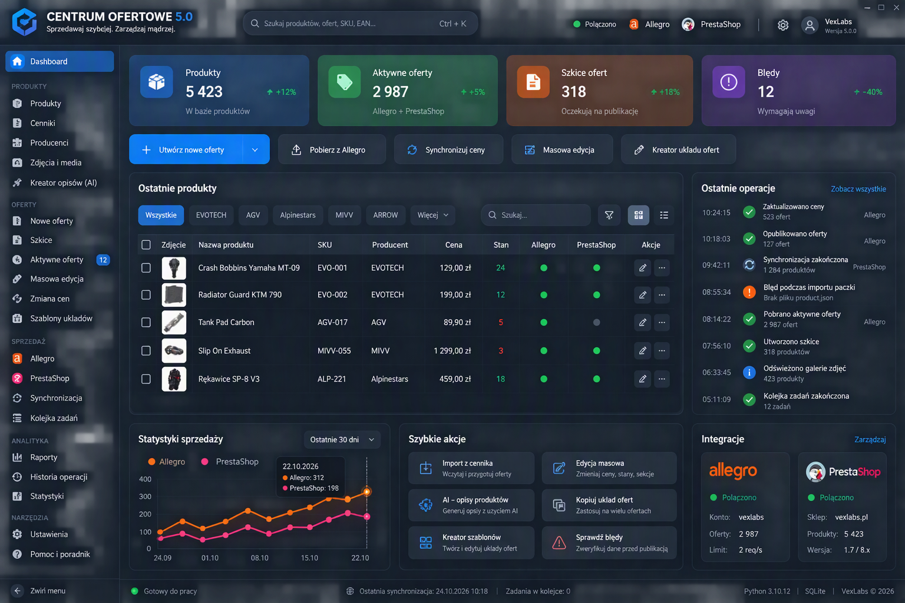

# CENTRUM OFERTOWE

Projekt aplikacji desktopowej Windows do długoterminowego zarządzania procesami sprzedaży. Fundamentem jest wspólny model domenowy, a integracje z platformami i systemami zewnętrznymi są jego adapterami. Aplikacja nie jest ograniczona do obsługi Allegro.

## 1. Co zawiera ten pakiet

Wersja dokumentacji: 0.3, stan 2026-11-02. Pakiet zawiera siedem polskojęzycznych plików Markdown. **Nie zawiera działającej aplikacji, kodu biznesowego, konfiguracji środowiska, migracji ani instalatora.**

To całkowicie nowy, samodzielny plan projektu. Nie wymaga wyszukiwania wcześniejszej dokumentacji ani odtwarzania dawnych decyzji. Pakiet powstał poza repozytorium i zawiera również ZIP do przeniesienia do nowego projektu.

Status dokumentów: projekt do przeglądu. WYMAGANIA wynikają z polecenia; PROPOZYCJE są nowymi szczegółami; NIEUSTALONE oznacza brak danych; KONFLIKTY wymagają jawnego rozstrzygnięcia. Sam zapis plików nie oznacza akceptacji propozycji.

## 2. Mapa dokumentacji

| Plik | Przeznaczenie |
|---|---|
| [AGENTS.md](AGENTS.md) | Instrukcje pracy Codex, analiza przed zmianą i kontrola jakości |
| [ARCHITECTURE_CONSTITUTION.md](ARCHITECTURE_CONSTITUTION.md) | Warstwy, granice, transakcje, integracje, bezpieczeństwo i migracje |
| [DOMAIN_MODEL.md](DOMAIN_MODEL.md) | 16 bytów, odpowiedzialności, proponowane właściwości i niezmienniki |
| [UI_UX_DESIGN_SYSTEM.md](UI_UX_DESIGN_SYSTEM.md) | Fluent UI, komponenty, motywy, dostępność, DPI i QFluentWidgets |
| [ROADMAP.md](ROADMAP.md) | 12 etapów z zależnościami, artefaktami i testami |
| [ADR_INDEX.md](ADR_INDEX.md) | Nowe decyzje ADR-001 i kolejne, propozycje, pytania i konflikty |
| [README.md](README.md) | Punkt wejścia i sposób wykorzystania pakietu |

## 3. Stos wymagany

| Technologia | Rola |
|---|---|
| Python | Język aplikacji; wersja do ustalenia |
| PySide6 / Qt for Python | Interfejs Windows |
| SQLite | Lokalna trwałość danych |
| Clean Architecture | Kierunek zależności i izolacja szczegółów |
| DDD | Znaczenie pojęć, niezmienniki i granice modelu |
| pytest | Testy zachowania |
| ruff | Lintowanie i formatowanie |
| mypy | Kontrola typowania |
| import-linter | Automatyczna kontrola granic importów |
| bandit | Analiza wybranych ryzyk bezpieczeństwa kodu |
| pip-audit | Kontrola znanych podatności zależności |

Nie wybrano ORM, narzędzia migracji, menedżera zależności, systemu pakowania, biblioteki zadań, magazynu sekretów ani kolejności integracji pierwszego wydania. Allegro i PrestaShop są wymaganymi kierunkami integracji widocznymi na wzorcu UI; kolejność realizacji pozostaje do ustalenia. QFluentWidgets jest kandydatem, nie zatwierdzonym składnikiem stosu.

## 4. Model i zasady nadrzędne

Główne byty: Produkt, Producent, PodmiotGPSR, Dostawca, KanałSprzedaży, KontoSprzedażowe, Oferta, Klient, Zamówienie, Dokument, Przesyłka, Wątek, Wiadomość, Reguła, Zdarzenie i Operacja.

Produkt jest niezależny od platform. Oferta jest jego prezentacją. Producent, Dostawca i PodmiotGPSR pozostają odrębni. KanałSprzedaży nie jest kontem ani przewoźnikiem. W komunikacji obowiązuje określenie „Środek komunikacji”. Integracje nie budują konkurencyjnych kartotek. Pierwsze uruchomienie nie tworzy przykładowych danych biznesowych.

Szczegółowe relacje, liczności i zasady w kartach modelu są propozycjami. Brak potwierdzenia nie upoważnia do ich utrwalenia w schemacie bazy.

## 5. Proponowana struktura przyszłego repozytorium

Poniższe drzewo opisuje plan; katalogi kodu i konfiguracja nie zostały utworzone w tym zadaniu.

```text
CENTRUM_OFERTOWE/
├── AGENTS.md
├── ARCHITECTURE_CONSTITUTION.md
├── DOMAIN_MODEL.md
├── UI_UX_DESIGN_SYSTEM.md
├── ROADMAP.md
├── ADR_INDEX.md
├── README.md
├── pyproject.toml                 # przyszła konfiguracja
├── src/
│   └── centrum_ofertowe/
│       ├── rdzen/
│       ├── domena/
│       ├── przypadki_uzycia/
│       ├── adaptery/
│       ├── kanaly/
│       ├── gui/
│       └── bootstrap.py           # propozycja punktu składania
├── tests/
│   ├── unit/
│   ├── application/
│   ├── integration/
│   ├── contracts/
│   ├── gui/
│   ├── migration/
│   └── performance/
└── docs/
    └── adr/                      # przyszłe pełne decyzje
```

`rdzen` nie jest magazynem wszystkich współdzielonych reguł. Domena jest niezależna od Qt, SQL i API. Przypadki użycia udostępniają porty. `adaptery`, `kanaly` i `gui` są zewnętrznymi, równorzędnymi obszarami. Dokładny graf oraz proponowany wyjątek dla bootstrapu są w konstytucji i wymagają decyzji P-01.

Dane użytkownika przechowywać poza repozytorium i katalogiem instalacji; dokładna ścieżka jest nieustalona. Nie dodawać bazy użytkownika, kopii, tokenów ani rzeczywistych danych testowych do systemu kontroli wersji.

## 6. Przygotowanie i uruchamianie

**Dzisiaj:** otwórz dokumenty; tego pakietu nie da się uruchomić jako aplikacji. Nie ma punktu wejścia ani listy zależności do instalacji.

**Docelowo, po realizacji etapu 1:** wybrać wspieraną wersję Pythona, utworzyć środowisko, zainstalować przypięte zależności zgodnie z rzeczywistą konfiguracją i uruchomić uzgodniony punkt wejścia. Przykładowe utworzenie środowiska w PowerShell, dopiero po instalacji wybranej wersji Pythona:

```powershell
python -m venv .venv
.\.venv\Scripts\python.exe --version
```

Nie podano polecenia instalacji projektu ani startu aplikacji, ponieważ nie istnieją jeszcze `pyproject.toml`, zatwierdzone grupy zależności i punkt wejścia. Należy uzupełnić tę sekcję w etapie 1/2 na podstawie działającej konfiguracji. Nie obniżać globalnie polityki bezpieczeństwa PowerShell tylko po to, by aktywować środowisko; można używać bezpośredniej ścieżki interpretera.

Nowe uruchomienie produkcyjne ma tworzyć jedynie strukturę techniczną i pustą bazę biznesową. Import danych i powiązanie kont to świadome czynności użytkownika.

## 7. Testy i narzędzia jakości

Docelowe polecenia po utworzeniu konfiguracji i instalacji narzędzi:

```powershell
python -m pytest
python -m ruff check .
python -m ruff format --check .
python -m mypy src
lint-imports
python -m bandit -r src
python -m pip_audit
```

Uruchamiać w środowisku projektu; w razie braku aktywacji poprzedzić interpreter ścieżką `.\.venv\Scripts\python.exe`, a `lint-imports` wywołać z katalogu `Scripts` tego środowiska. Kontrakty import-linter i zakres analizy wymagają przyszłej konfiguracji.

Są to instrukcje docelowe, nie raport wykonanych testów. W tym zadaniu sprawdzana jest dokumentacja: komplet siedmiu nazw, obecność 16 bytów i 12 etapów, wzajemne odnośniki, oznaczenia propozycji i komplet archiwum. Nie uruchamiano testów aplikacji, bo nie dostarczono kodu.

Testy nie mogą korzystać z produkcyjnej bazy ani wykonywać rzeczywistych publikacji i wysyłek. Testy domeny są niezależne od Qt i SQL. Migracje, SQLite, integracje i GUI wymagają osobnych testów opisanych w konstytucji i roadmapie.

## 8. UI i licencje

Wymagany jest współdzielony Design System inspirowany Fluent Design: nowoczesna typografia, zaokrąglenia, subtelna głębia, nawigacja boczna, tabele, dopracowane formularze, motywy i dostępność. Nie wolno tworzyć niezależnych stylów każdej podstrony.

Sprawdzenie QFluentWidgets z 2026-11-01: [LICENSE gałęzi PySide6](https://raw.githubusercontent.com/zhiyiYo/PyQt-Fluent-Widgets/PySide6/LICENSE) wskazuje GPL v3, a [producent](https://qfluentwidgets.com/pages/pro/) opisuje wariant komercyjny. Nie zatwierdzono wersji, umowy ani zgodności z modelem dystrybucji CENTRUM OFERTOWE. Szczegóły i bramka adopcji są w systemie UI. Nie należy zakładać, że licencja PySide6 automatycznie obejmuje QFluentWidgets, ikony, fonty i zależności przechodnie.

Nie nadano licencji samemu projektowi ani dokumentacji w imieniu właściciela. Należy uzgodnić ją przed publiczną dystrybucją.

## 9. Jak wprowadzić pakiet do repozytorium

1. Utworzyć repozytorium nowego projektu w wybranym miejscu.
2. Umieścić w nim siedem dokumentów jako początkową dokumentację.
3. Rozpocząć własny rejestr decyzji od ADR-001, bez zależności od dawnej numeracji.
4. Rozpatrzyć propozycje P-xx, pytania Q-xx i konflikty K-xx. Oznaczyć osobę, datę i zakres każdej akceptacji.
5. Wprowadzić uzgodnione dokumenty jako osobną zmianę dokumentacyjną; nie łączyć tego z implementacją funkcjonalności.
6. Dopiero potem rozpocząć kolejne etapy roadmapy.

Archiwum `CENTRUM_OFERTOWE_dokumentacja.zip` zawiera siedem plików Markdown w katalogu głównym oraz obraz `assets/UI_REFERENCE.png`, będący wzorcem interfejsu przekazanym przez użytkownika. Można je rozpakować do katalogu przeglądu. Nie rozpakowywać bez porównania bezpośrednio na zatwierdzoną dokumentację.

## 10. Otwarte sprawy i ograniczenia

Najważniejsze braki: wybór miejsca na nowe repozytorium, akceptacja szczegółów nowego modelu, własność synchronizowanych pól, wersje zależności, topologia danych, zasady retencji i dystrybucji. Pełny rejestr: [ADR_INDEX](ADR_INDEX.md).

Pakiet stanowi gotowy materiał do przeglądu i dalszego prowadzenia projektu. Nie jest dowodem zgodności prawnej, pomiarów wydajności ani ukończenia aplikacji.

## 11. Docelowy wygląd i opcje — UI-REF-01

**Wymaganie użytkownika: program ma wyglądać jak poniższy ekran.** To obowiązujący wzorzec, który uszczegóławia ogólny kierunek Fluent Design.



Układ obejmuje ciemną granatową powłokę, niebieskie akcje, boczną nawigację, globalną wyszukiwarkę Ctrl+K, cztery kolorowe KPI, pasek działań, tabelę Produktów z miniaturami i statusami platform, ostatnie Operacje oraz dolne panele: Statystyki sprzedaży, Szybkie akcje i Integracje. Na dole znajduje się pasek gotowości, synchronizacji i kolejki.

Zakres funkcji rozszerzono o:

- Cenniki, import z cennika, zmianę i synchronizację cen oraz masową edycję.
- Zdjęcia i media oraz generowanie propozycji opisów AI.
- Tworzenie nowych Ofert, szkice, aktywne Oferty, kreator układu, szablony i kopiowanie układu.
- Allegro i PrestaShop, pobieranie danych z Allegro, synchronizację, kolejkę i historię Operacji.
- Walidację błędów, raporty, statystyki i wykres porównujący obie platformy.
- Ustawienia, profil lokalny, Pomoc i poradnik oraz zwijanie menu.

Dokładne menu, kolumny tabeli, zachowanie przycisków, stany i odbiór wizualny: [system UI, sekcje 15–23](UI_UX_DESIGN_SYSTEM.md). Wpływ na domenę: [model, sekcja 9](DOMAIN_MODEL.md). Architektura rozszerzeń: [konstytucja, sekcja 14](ARCHITECTURE_CONSTITUTION.md). Harmonogram: [roadmapa, sekcja 16](ROADMAP.md). Nowe decyzje: [ADR-012–ADR-016](ADR_INDEX.md).

Wymagany wygląd i opcje są ustalone poleceniem użytkownika. Nieustalone pozostają szczegóły niewynikające z obrazu: właściciel ceny/ilości, struktura Cennika i szablonu, dostawca AI, znaczenie osi wykresu oraz kolejność wdrażania integracji. Dokumenty oznaczają je jako propozycje, zamiast wprowadzać ukryte reguły.

Nazwy produktów, producentów, konta `vexlabs`, domena sklepu, liczby, daty, limity i wersje na ekranie są demonstracyjne. Nie zasilają czystej instalacji. Etykieta 5.0 nie oznacza, że aplikacja została zaimplementowana ani wydana. Realna wersja i informacje techniczne pochodzą z metadanych.

Archiwum wersji 0.3 zawiera 7 dokumentów i referencyjny PNG. W tym zadaniu zaktualizowano dokumentację; aplikacja nie została zaimplementowana. Odbiór wizualny działającego programu będzie pracą przyszłego etapu, a nie wynikiem obecnej aktualizacji.
