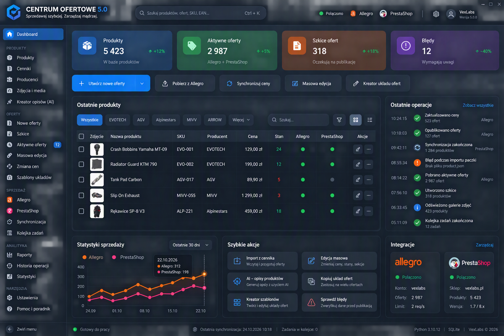

# CENTRUM OFERTOWE — system projektowania UI i UX

Wersja 0.3 • 2026-11-02 • specyfikacja do przeglądu.

## 1. Cel i status

WYMAGANIE: nowoczesna aplikacja PySide6 inspirowana Microsoft Fluent Design i Windows 11. Spójny system współdzielonych komponentów, nawigacja boczna, nowoczesne tabele, formularze, dialogi, powiadomienia, postęp, obsługa motywów, DPI, klawiatury i technologii wspomagających. Efekty wizualne nie mogą pogarszać użyteczności ani wydajności.

WYMAGANIE UI-REF-01: załączony przez użytkownika ekran jest obowiązującym wzorcem wyglądu i widocznych opcji. Jego ciemna granatowa kolorystyka, kompozycja dashboardu, menu i hierarchia wizualna zastępują wcześniejszą ogólną propozycję UI. Szczegółowe zachowania niewidoczne na obrazie, tokeny odtworzone przybliżeniowo i rozwiązania techniczne pozostają PROPOZYCJAMI. Nie istnieje jeszcze implementacja. Pełna specyfikacja wzorca i kryteria odbioru znajdują się w sekcjach 15–23.

## 2. Architektura prezentacji — propozycja

Podział `gui`: `design_system` (tokeny i wspólne komponenty), `shell` (okno, nawigacja, kontekst), `views` (strony), `viewmodels` (stan i intencje), `models` (modele Qt list/tabel) oraz `resources` (ikony i tłumaczenia). Dokładne katalogi są propozycją, mieszczą się w warstwie `gui`.

Widok posiada układ, wiązanie kontrolek i kolejność fokusu. Model widoku posiada stan ekranu, aktywne filtry, walidację formatu i wywołanie przypadku użycia. Przypadek użycia rozstrzyga proces, a domena legalność zmiany. Model tabeli Qt adaptuje wynik zapytania; nie jest repozytorium ani encją domenową.

Nie przekazywać `QWidget`, `QObject`, sygnału, `QModelIndex` ani `QVariant` do przypadków użycia. Zwracać zwykłe DTO. Ewentualny `QObject` modelu widoku należy do GUI. Błędy domenowe mapować na komunikaty i pola za pośrednictwem stabilnych kodów, nie przez analizowanie tekstu wyjątku.

Warstwa komponentów ma ukrywać zależność od QFluentWidgets, jeśli zostanie wybrana. Publiczne API ekranów nie powinno wymagać klas tej biblioteki. Wymiana komponentu wizualnego nie zmienia Produktu ani przypadku publikacji Oferty.

## 3. Tokeny i motywy — propozycja

Token semantyczny opisuje rolę, np. `surface.card`, zamiast lokalnego koloru `gray_17`. Kontrolki korzystają z tokenów i wariantów; nie mają własnej palety QSS na każdej stronie. Właścicielem tokenów jest Design System, a zmianę sprawdza się w galerii komponentów dla obu motywów i wszystkich stanów.

| Token | Jasny | Ciemny | Zastosowanie |
|---|---|---|---|
| `surface.window` | `#F3F6FA` | `#0B1420` | Tło okna |
| `surface.card` | `#FFFFFF` | `#101C29` | Karty i formularze |
| `surface.raised` | `#FFFFFF` | `#1E2B3C` | Menu i dialogi |
| `text.primary` | `#172235` | `#F4F7FC` | Główna treść |
| `text.secondary` | `#52647A` | `#A4B2C5` | Opisy |
| `accent.fill` | `#0068D7` | `#0078F5` | Główna akcja |
| `accent.on_fill` | `#FFFFFF` | `#FFFFFF` | Tekst na akcencie |
| `border.decorative` | `#D6DFEB` | `#26384B` | Delikatne podziały |
| `border.control` | `#707070` | `#A0A0A0` | Istotna granica pola |
| `state.error` | `#B42318` | `#FFB4AB` | Błędy |
| `state.success` | `#146C2E` | `#8FE0A4` | Powodzenie |
| `state.warning` | `#7A4B00` | `#FFD58A` | Ostrzeżenia |

Wartości są przybliżeniem wzorca UI-REF-01, nie wynikiem pomiaru pikseli ani audytu kontrastu. Jasny motyw jest wariantem pochodnym. Biały tekst na niebieskim przycisku wymaga pomiaru i w razie potrzeby przyciemnienia tła bez zmiany charakteru wzorca. Dla każdego rzeczywistego zestawienia tekst/tło i stanu hover/disabled/selected trzeba zmierzyć kontrast. Proponowane kryteria produktu: 4,5:1 dla zwykłego tekstu, 3:1 dla dużego tekstu i istotnych elementów graficznych; mają charakter kryteriów projektu, nie deklaracji certyfikacji dostępności.

Motywy: jasny, ciemny i systemowy. Preferencję zapisywać technicznie, bez tworzenia danych biznesowych. Tryb systemowy reaguje na zmianę Windows podczas pracy; jawny wybór użytkownika ma pierwszeństwo. Motyw wysokiego kontrastu powinien używać kolorów systemowych i widocznego fokusu zamiast przezroczystości. Nie polegać na samym kolorze: status ma nazwę i ikonę.

## 4. Typografia, miary i głębia — propozycja

Rodzina: Segoe UI Variable, jeśli dostępna, następnie Segoe UI i font systemowy. Nie dołączać plików fontu bez sprawdzenia praw redystrybucji. Dla tekstu skalowalnego preferować jednostki punktowe; geometria w logicznych jednostkach Qt, nigdy mnożona ręcznie ponownie przez współczynnik DPI.

| Rola | Rozmiar | Waga | Użycie |
|---|---|---|---|
| Nagłówek strony | 22 pt | Semibold | Jeden główny tytuł |
| Nagłówek sekcji | 16 pt | Semibold | Grupy treści |
| Tekst podstawowy | 10,5 pt | Regular | Formularze i tabele |
| Etykieta | 10,5 pt | Semibold | Krótkie nazwy pól |
| Pomocniczy | 9,5 pt | Regular | Opisy i metadane |

Skala odstępów: 4, 8, 12, 16, 24, 32, 48 logicznych jednostek. Margines strony 16, karty 16, odstęp etykieta–pole 8, odstęp między polami 16. Promienie: 4 dla drobnych elementów, 8 dla kontrolek i kart, 12 dla dialogów. Wysokość standardowej kontrolki 36, wiersza tabeli 48; to wartości minimalne przy domyślnym foncie, nie sztywne ograniczenie przy większym tekście.

Cienie stosować jedynie dla elementów ponad treścią: menu, flyout i dialog. Karty zwykle rozdzielać tłem i obramowaniem. Mica/Acrylic są opcjonalne i wymagają oceny technicznej; przy braku wsparcia używać pełnego tła. Czytelność nie może zależeć od obrazu pulpitu.

## 5. Powłoka i nawigacja — propozycja

Okno: pasek tytułu z nazwą aplikacji i standardową obsługą Windows, lewa nawigacja, obszar roboczy, lokalny nagłówek strony i miejsce na status długiej pracy. Zachować minimalizację, maksymalizację, przeciąganie, układ wielu monitorów i systemowe skróty. Niestandardowa ramka wymaga osobnego prototypu dostępności i zachowania Windows.

WYMAGANIE: menu główne ma zachować grupy i pozycje widoczne na UI-REF-01: Dashboard; PRODUKTY; OFERTY; SPRZEDAŻ; ANALITYKA; NARZĘDZIA. Dokładna lista i kolejność są w sekcji 17. Dodatkowe moduły pierwotnego modelu są dostępne przez nawigację drugiego poziomu opisaną tamże, bez samowolnej przebudowy menu wzorca.

Nawigacja ma ikonę, nazwę i jednoznaczne zaznaczenie aktywnej strony. W zwinięciu ikony otrzymują etykiety dostępności i podpowiedzi. Filtry i pozycję listy zachowywać przy wejściu w szczegóły i powrocie. Zmiana aktywnego konta musi być widoczna i nie może po cichu przepinać edytowanej Oferty.

Proponowane zachowanie szerokości: od 1280 — pełna nawigacja i panel szczegółów; 960–1279 — zwinięta nawigacja, panel opcjonalny; poniżej 960 — nakładana nawigacja i szczegóły w osobnym widoku. Progi mierzone w jednostkach logicznych, do weryfikacji przy dużym tekście. Nie ustalono minimalnej wspieranej rozdzielczości.

## 6. Standard strony i stanów

Każda strona ma tytuł, krótką informację o zakresie danych, jedną wyraźną akcję główną i przewidywalne akcje pomocnicze. Filtry są oddzielone od narzędzi edycji. Liczba zaznaczonych rekordów jest widoczna przy akcjach masowych.

| Stan P | Prezentacja | Dostępna reakcja |
|---|---|---|
| Pierwsze użycie | Brak danych, opis celu modułu | Dodaj pierwszy rekord; import tylko jeśli wdrożony |
| Brak wyników | Aktywne warunki wyszukiwania | Wyczyść filtry |
| Ładowanie | Stabilny układ, wskaźnik i opis | Anuluj oczekiwanie, jeśli obsługiwane |
| Brak połączenia | Dane z czasem ostatniego odczytu | Ponów lub pracuj lokalnie w dozwolonym zakresie |
| Błąd | Zrozumiały opis i zachowanie danych formularza | Napraw, ponów, pokaż identyfikator diagnostyczny |
| Konflikt | Wersja lokalna i źródłowa z opisem różnic | Porównaj i świadomie rozstrzygnij |
| Ograniczone uprawnienia | Wyjaśnienie przy niedostępnej akcji | Instrukcja uzyskania dostępu |

Nie zastępować błędu pustą tabelą. Nie wyświetlać fałszywych statystyk demonstracyjnych w nowej instalacji. Szkielety ładowania nie powinny migać przy krótkich odczytach.

## 7. Katalog komponentów — propozycja

| Komponent | Kontrakt i wymagane stany |
|---|---|
| `AppButton` | Primary/secondary/subtle/danger, normal/hover/pressed/focus/disabled/busy; stan busy blokuje duplikat |
| `FormField` | Etykieta, pole, pomoc, wymaganie, błąd; identyczny odstęp i dostępna nazwa |
| `SearchBox` | Szukanie, czyszczenie, opis zakresu, stan wykonywania |
| `FilterBar` | Aktywne filtry, reset, zapis zestawu tylko jeśli zatwierdzony |
| `DataTable` | Model Qt, sortowanie, zaznaczenie, paginacja, komunikat pustki |
| `StatusBadge` | Tekst i ikona, znaczenie niezależne od koloru |
| `SectionCard` | Tytuł, treść i opcjonalna akcja; bez lokalnego stylowania |
| `InlineMessage` | Informacja/warning/error/success, akcja i dostępna etykieta |
| `OperationPanel` | Stan, postęp, próby, żądanie anulowania i wynik |
| `ConfirmDialog` | Konkretny skutek, zakres i przyciski opisujące czynność |
| `EmptyState` | Cel strony i możliwy następny krok bez fikcyjnych danych |

Każdy komponent ma galerię stanów w jasnym i ciemnym motywie, test klawiatury, dużego tekstu, długich polskich etykiet i błędu. Nowa strona składa istniejące komponenty; nowy wariant trafia do galerii przed powieleniem go w kilku miejscach.

## 8. Tabele danych

WYMAGANIE: sortowanie, filtrowanie i wyszukiwanie. PROPOZYCJA: `QTableView` i wyspecjalizowany `QAbstractTableModel`, delegaty do renderowania statusów; bez osobnego widżetu w każdej komórce. `QSortFilterProxyModel` tylko gdy cały przeszukiwany zbiór faktycznie jest lokalnie w modelu. Przy stronicowaniu sortowanie i filtr muszą obejmować cały wynik zapytania, a nie wyłącznie widoczną stronę.

Nagłówki mają nazwę i kierunek sortowania. Sortowanie jest deterministyczne z dodatkowym stabilnym kluczem. Kwoty wyrównane do prawej, liczby z jednostką i walutą, daty z jawnym znaczeniem. Długi tekst skracany wizualnie z możliwością odczytu całości. Nie ukrywać istotnego błędu wyłącznie w tooltipie.

Wiersz ma stan focus, hover, zaznaczenie i błąd. Zaznaczenie masowe jawnie określa „bieżąca strona” lub „wszystkie wyniki”. Akcja masowa pokazuje zakres i częściowe wyniki; jeden błąd nie może zniknąć w zbiorczym komunikacie „gotowe”.

Zapytania uruchamiać po proponowanym opóźnieniu 300 ms od wpisywania, z możliwością natychmiastowego Enter. Starsza odpowiedź nie nadpisuje nowszego zapytania. Filtry opisują operator i zakres, np. daty od–do wraz ze strefą. Rozmiar strony, indeksy i strategia wirtualizacji wynikają z pomiarów.

## 9. Formularze i walidacja

Etykieta jest nad polem lub w spójnym układzie dwukolumnowym przy odpowiedniej szerokości. Placeholder jest przykładem, nie zastępuje etykiety. Pola wymagane mają zrozumiałe oznaczenie i wyjaśnienie. Pomoc pojawia się przy polu, zanim wystąpi błąd.

GUI waliduje format i kompletność wejścia dla wygody. Ostateczna walidacja reguł następuje w przypadku użycia/domenie. Komunikat wskazuje, co poprawić; formularz zachowuje wpisane dane. Błędy wielu pól mają podsumowanie z przejściem do pierwszego błędu. Nie zgadywać wartości brakujących w imporcie.

„Zapisz” zapisuje lokalną zmianę. „Opublikuj” lub „Wyślij” uruchamia odrębny skutek zewnętrzny. Jeśli proces łączy oba kroki, nazwa przycisku i potwierdzenie muszą pokazywać oba skutki. Wyjście z niezapisanymi zmianami oferuje zapisz/porzuć/wróć; nie tracić danych przy błędzie sieci.

Współbieżna edycja nie kończy się cichym nadpisaniem. Ekran porównania pokazuje pola zmienione lokalnie i w źródle. Wrażliwych danych nie kopiować automatycznie do schowka.

## 10. Dialogi, powiadomienia i błędy

Modalność stosować dla decyzji blokującej bieżący proces. Informacje i postęp mają panel w kontekście pracy. Dialog potwierdzenia opisuje obiekt, zakres i skutek, np. „Zakończ publikację 12 ofert”, zamiast „Czy na pewno?”. Domyślny fokus dla ryzykownej czynności powinien pozostać na bezpiecznej akcji.

Powiadomienie o sukcesie jest krótkie i nie przejmuje fokusu. Błąd wymagający działania pozostaje dostępny po zniknięciu powiadomienia. Czasowe komunikaty muszą być możliwe do odnalezienia w centrum Operacji, jeśli dotyczą trwałej pracy.

Komunikat błędu: co nie zadziałało, czy dane zostały zapisane, co można zrobić, identyfikator diagnostyczny. Bez tracebacku, tokenów i surowego payloadu. Przykład P: „Nie potwierdzono publikacji oferty. Sprawdzamy wynik po stronie serwisu. Nie zlecaj jej ponownie.” — tylko jeśli aplikacja faktycznie uruchamia takie sprawdzenie.

## 11. Postęp, animacje i wydajność

Znany postęp pokazuje licznik i procent oparty na rzeczywistej pracy. Nieznany używa wskaźnika nieokreślonego. Wieloetapowa Operacja pokazuje etap, nie pozornie precyzyjny procent. Kliknięcie „Anuluj” zmienia stan na „Zażądano anulowania”, dopóki wykonawca nie potwierdzi wyniku.

Proponowane animacje 100–200 ms: łagodne przejścia stanów, bez animowania dużych tabel przy każdym odświeżeniu. Preferencja ograniczenia animacji wyłącza zbędny ruch. Nie opierać informacji wyłącznie na animacji i nie stosować błysków.

Proponowane cele do pomiaru: reakcja wizualna na lokalny przycisk do 100 ms; informacja o trwaniu pracy do 300 ms; brak ciągłego blokowania pętli UI powyżej 50 ms podczas zwykłej interakcji. To cele, nie gwarancje ani wyniki testów. Sprzęt referencyjny i wolumeny danych trzeba ustalić w etapie 5.

Kosztowne I/O i obliczenia poza wątkiem GUI, porcjowanie wyników, ograniczanie lawiny sygnałów, miniatury w cache o limicie pamięci. Nigdy nie używać `sleep` ani synchronicznego żądania HTTP w obsłudze kliknięcia. Strategia zadań i integracji z asyncio jest N.

## 12. Dostępność i DPI

WYMAGANIE: pełna nawigacja klawiaturą, widoczne stany, skalowanie systemowe, technologie wspomagające, ograniczanie ruchu. PROPOZYCJA testów: Tab/Shift+Tab, Enter, Escape, strzałki w listach, przewidywalny powrót fokusu po zamknięciu dialogu. Nie tworzyć pułapek fokusu w panelu ani wymagać myszy do akcji wiersza.

Każda kontrolka ma dostępną nazwę, rolę i stan. Ikona bez tekstu ma nazwę czynności. Informacje błędów są powiązane z polami i sprawdzane z Narratorem Windows; samo ustawienie `accessibleName` nie kończy testu. Wymagany Ctrl+K otwiera wyszukiwanie globalne zgodnie ze wzorcem. Proponowane pozostałe skróty: Ctrl+F do szukania na bieżącej stronie, Ctrl+S do lokalnego zapisu; wymagają kontroli konfliktów.

Macierz wizualna obejmuje 100%, 125%, 150%, 200% skalowania, dwa monitory o różnym DPI, jasny/ciemny/wysoki kontrast, długie etykiety oraz powiększony tekst. Po przeniesieniu okna nie może być uciętych przycisków ani rozmazanych ikon. Używać skalowalnych zasobów ikon; stała wysokość pola nie może przycinać tekstu.

## 13. QFluentWidgets — sprawdzenie i bramka wyboru

Sprawdzono 2026-11-01 źródła pierwotne: [LICENSE gałęzi PySide6](https://raw.githubusercontent.com/zhiyiYo/PyQt-Fluent-Widgets/PySide6/LICENSE), [informacje producenta](https://qfluentwidgets.com/pages/about/), [oferta Pro](https://qfluentwidgets.com/pages/pro/) i [README wariantu PySide6](https://github.com/zhiyiYo/PyQt-Fluent-Widgets/tree/PySide6).

Plik LICENSE wskazuje GNU GPL v3. Producent przedstawia także wariant komercyjny. To nie jest biblioteka na domyślnie liberalnej licencji. Nie wybrano wersji ani modelu dystrybucji aplikacji, więc nie zatwierdzono podstawy jej użycia. Zasady użycia komercyjnego trzeba odnieść do konkretnej umowy; GPL sama w sobie nie jest ogólnym zakazem działalności komercyjnej. Niniejszy zapis jest kontrolą źródeł, nie opinią prawną.

README ostrzega przed jednoczesną instalacją wariantów PyQt/PySide używających tej samej nazwy importu `qfluentwidgets`. Wybór powinien dotyczyć wyłącznie wariantu PySide6. Nie przeprowadzono testu zgodności z żadną przypiętą wersją PySide6 ani audytu zależności przechodnich.

Przed dopuszczeniem biblioteki wymagany pakiet dowodów P: wersja/tag i hash, kopia warunków z datą, zgodność planowanej dystrybucji i modyfikacji, warunki aktualizacji/wsparcia, lista zależności i ich licencji, test motywów/DPI/Narratora, test wydajności tabel, próbna wymiana komponentu i ocena utrzymania. Ceny, zakres licencji komercyjnej i kompatybilność pozostają N.

Alternatywa P: PySide6 Widgets z własną cienką warstwą tokenów i komponentów Fluent. Zachowuje ten sam model aplikacyjny. Nie uruchamiać automatycznego zakupu ani nie dodawać zależności QFluentWidgets przed decyzją.

## 14. Kryteria odbioru strony

Przegląd potwierdza: wspólne tokeny, wszystkie stany danych, brak SQL i reguł biznesowych w GUI, pełną obsługę klawiatury, komunikaty technologii wspomagających, brak ucięć przy DPI, zachowanie formularza po błędzie, prawdziwy postęp i jawny zakres skutków zewnętrznych. Do odbioru dołączyć zrzuty obu motywów i wynik scenariuszy; zrzuty nie zastępują testu interakcji.

## 15. UI-REF-01 — obowiązujący wzorzec wizualny

Użytkownik wskazał obraz „to wygeneruj.png” poleceniem „Program ma wyglądać tak”. Kopia referencyjna jest częścią pakietu:

**WYMAGANIE:** odtworzyć charakter, kompozycję i opcje tego ekranu w natywnej aplikacji PySide6. To nie jest luźna inspiracja i nie wolno zastąpić go standardowym jasnoszarym formularzem Qt ani innym układem dashboardu. Główny wariant odbioru to ciemny interfejs granatowo-grafitowy, nasycony niebieski akcent, subtelne obramowania, kolorowe karty KPI i gęsty, uporządkowany panel zarządzania.

Obraz jest wzorcem wyglądu i widocznego zakresu, nie dowodem działania API ani źródłem danych konfiguracyjnych. Nazwy firm, konta, adres sklepu, produkty, producenci, ceny, liczby, daty, limity i wersje na nim są demonstracyjne. Nie tworzyć na ich podstawie rekordów biznesowych ani twardo wpisanej konfiguracji. Widoczna nazwa „CENTRUM OFERTOWE 5.0” określa wzorzec nagłówka; wersję uruchomionej aplikacji pobierać z metadanych wydania. Nie ogłaszać ukończonego wydania 5.0 na podstawie makiety.

Wymiary widocznego obrazu: 1536 × 1024 piksele. Współczynnik DPI jego środowiska jest nieznany. Poniższe wartości geometrii są przybliżeniem projektowym przy 100% skali, nie pomiarem Qt ani wymogiem sztywnych współrzędnych. Responsywny układ i dostępność mają zachować hierarchię wzorca.

## 16. Geometria i oprawa dashboardu

| Obszar | Przybliżenie wzorca | Reguła implementacyjna |
|---|---|---|
| Górny pasek | Pełna szerokość, wysokość ok. 76 | Logo i marka po lewej, globalne szukanie, stan integracji, ustawienia i profil po prawej |
| Boczne menu | Szerokość ok. 203, od nagłówka do stopki | Własny przewijany obszar; „Zwiń menu” przy dolnej krawędzi |
| Obszar główny | Od x≈219; odstępy 14–16 | Layout Qt, bez absolutnego pozycjonowania |
| Wiersz KPI | Cztery karty o wysokości ok. 120 | Równe szerokości, odstępy 14–16 |
| Pasek akcji | Wysokość ok. 50, pod KPI | Jedna akcja główna split-button oraz cztery akcje wtórne |
| Środkowy rząd | Wysokość ok. 410 | Ostatnie produkty ok. 73%, Ostatnie operacje ok. 27% |
| Dolny rząd | Wysokość ok. 250 | Statystyki ok. 35%, Szybkie akcje ok. 38%, Integracje ok. 27% |
| Pasek stanu | Pełna szerokość, wysokość ok. 40 | Stan pracy, synchronizacja, kolejka; metadane techniczne dyskretne |

Karty i panele mają promienie ok. 10–12, cienką granatową linię i łagodny gradient. Nie tworzyć mocnych czarnych cieni pod każdym elementem. Tło powłoki jest głęboko granatowe; lekki niebieski blask można odtworzyć statycznym gradientem, bez kosztownego rozmywania całego okna. Tekst biały/off-white, drugorzędny szaroniebieski; ikony liniowe Fluent, w kaflach KPI pełne białe na kolorowym tle.

Dodatkowe tokeny P: `nav.selected=#1756A3`, `action.primary=#0078F5`, `chart.allegro=#FF710B`, `chart.prestashop=#F73787`, `status.connected=#19C66A`, `status.pending=#7C8C9F`, `status.failure=#FF5B37`. Karty KPI: niebieska (`#183451`→`#203F65`), zielona (`#154438`→`#225D4B`), pomarańczowo-brązowa (`#573329`→`#684A35`) i fioletowa (`#34274E`→`#463361`). Są to przybliżenia do dostrojenia przy porównaniu, nie zmierzone kolory wzorca.

Przy szerokim oknie zachować układ 4 KPI / tabela+operacje / trzy panele. Przy zwężaniu: KPI 2×2, przyciski zawijane, dolne panele do dwóch kolumn, następnie jednej. Panel Operacji schodzi pod tabelę zamiast ściskać kolumny do nieczytelności. Przy dużym DPI strona może przewijać się pionowo; nie zmniejszać fontu, aby wszystko zmieścić. Górny pasek może przenieść stany integracji do menu, zachowując dostęp do Ctrl+K.

## 17. Dokładna mapa nawigacji

Poniższa kolejność i nazwy są WYMAGANIEM wynikającym ze wzorca. Ikona i aktywne podświetlenie mają być zgodne stylistycznie z obrazem, a liczniki pochodzić z danych.

| Grupa | Pozycje w kolejności | Widok / zakres |
|---|---|---|
| Start | Dashboard | Ekran główny opisany w sekcjach 18–21 |
| PRODUKTY | Produkty; Cenniki; Producenci; Zdjęcia i media; Kreator opisów (AI) | Katalog, dane cenowe, rejestr producentów, zasoby, redakcja opisów |
| OFERTY | Nowe oferty; Szkice; Aktywne oferty; Masowa edycja; Zmiana cen; Szablony układów | Przygotowanie, stany publikacji, operacje zbiorcze, układ prezentacji |
| SPRZEDAŻ | Allegro; PrestaShop; Synchronizacja; Kolejka zadań | Obszary platform, uzgadnianie danych i wykonanie Operacji |
| ANALITYKA | Raporty; Historia operacji; Statystyki | Zestawienia, historia wykonania, wskaźniki |
| NARZĘDZIA | Ustawienia; Pomoc i poradnik | Konfiguracja oraz instrukcje kontekstowe |
| Stopka menu | Zwiń menu | Zmiana szerokości, nie zamknięcie modułu |

Pierwotne 16 bytów pozostaje w zakresie. Wzorzec nie pokazuje wszystkich ich ekranów. Proponowane uzupełnienie bez rozbudowania głównego menu: w „Produkty” zakładki Dostawcy i Podmioty GPSR; w „Ustawienia” Kanały sprzedaży, Konta sprzedażowe oraz Automatyzacje (Reguły i Zdarzenia); w obszarach Allegro/PrestaShop zakładki Oferty, Zamówienia, Klienci, Dokumenty, Przesyłki i Komunikacja (Wątki/Wiadomości). Są to widoki wspólnych modeli filtrowane kontekstem, nie osobne modele danej platformy. Docelowe umiejscowienie zakładek jest P; brak ich w obrazie nie usuwa bytów z modelu.

„Aktywne oferty” pokazuje badge tylko z rzeczywistą, zdefiniowaną liczbą; nie kopiować `12` z makiety. Dashboard jest aktywny na starcie. Po zwinięciu nawigacji zachować ikonę, tooltip, dostępną nazwę i wskaźnik zaznaczenia.

## 18. Górny pasek, KPI i przyciski główne

### 18.1. Nagłówek

Po lewej znak aplikacji w niebieskim stylu geometrycznym, obok „CENTRUM OFERTOWE” i wyróżniona wersja. Podtytuł ze wzorca: „Sprzedawaj szybciej. Zarządzaj mądrzej.”. Znak należy odtworzyć jako niezależny zasób o dobrej ostrości; obraz referencyjny nie zawiera źródła wektorowego. Nie stosować całego zrzutu jako tła gotowej aplikacji.

W środku wyszukiwarka: „Szukaj produktów, ofert, SKU, EAN...” z lupą i podpowiedzią Ctrl+K. P: wyniki pogrupowane na Produkty i Oferty, identyfikacja SKU/EAN, kontekst konta i przejście do obiektu; bez uruchamiania publikacji. Ochrona przed nadpisaniem wyniku nowszego wyszukiwania i działanie bez sieci dla danych lokalnych.

Po prawej: ogólny stan połączenia, skróty Allegro/PrestaShop, separator, ustawienia, awatar i nazwa lokalnego profilu. „VexLabs” nie jest domyślną nazwą konta. Ikony platform otrzymują tekstowe etykiety. Zielone „Połączono” wolno pokazać dopiero po rzeczywistym sprawdzeniu; przy jednym połączonym koncie i drugim błędnym pokazać częściowe połączenie i szczegóły, nie fałszywy globalny sukces.

### 18.2. Cztery karty KPI

| Karta | Kolor / ikona | Definicja proponowana | Kliknięcie |
|---|---|---|---|
| Produkty | Niebieski / paczka | Liczba niearchiwalnych Produktów w zakresie dashboardu | Lista Produktów |
| Aktywne oferty | Zielony / metka | Oferty o potwierdzonym aktywnym stanie zewnętrznym, zakres Allegro + PrestaShop | Aktywne oferty z tym samym filtrem |
| Szkice ofert | Pomarańczowy / dokument | Lokalne szkice niepotwierdzone jako opublikowane | Szkice |
| Błędy | Fioletowy / wykrzyknik w kole | Liczba nierozwiązanych problemów wymagających działania, po deduplikacji | Lista problemów z odnośnikami do obiektów |

WYMAGANIE: nazwy, kolejność i forma kart jak na wzorcu — ikona po lewej, nazwa nad dużą liczbą, opis pod spodem, zmiana po prawej. Definicje metryk P wymagają doprecyzowania zakresu/okresu. Spadek liczby błędów może być pozytywny; wzrost liczby Produktów nie zawsze oznacza wynik sprzedażowy. Kierunek i kolor zmiany wynikają z semantyki metryki. Nie kopiować dwuznacznego zapisu `+-40%`; prezentować `−40%` z opisem okresu. Przy braku porównania używać „Brak porównania”, przy mianowniku zero nie wyliczać pozornego procentu.

### 18.3. Pasek działań

| Akcja ze wzorca | Wymagany kierunek działania | Doprecyzowanie P |
|---|---|---|
| Utwórz nowe oferty | Główny niebieski split-button | Kreator: Produkty → konto/platforma → dane → walidacja → szkice; publikacja osobno i świadomie |
| Pobierz z Allegro | Import/uzgodnienie danych z wybranego konta | Wybrać zakres: oferty/produkty; podgląd mapowania i duplikatów; bez automatycznego drugiego katalogu |
| Synchronizuj ceny | Zlecenie uzgodnienia cen | Kierunek, źródło i zakres jawne; podgląd przed zmianą; kontrola konfliktu |
| Masowa edycja | Przejście do zbiorczej zmiany | Zaznaczone obiekty lub filtr, lista pól, podgląd różnic i wynik per obiekt |
| Kreator układu ofert | Otwiera edytor układu | Sekcje, media i powiązania pól, podgląd platformy, zapis wersji szablonu |

Strzałka split-button otwiera menu wariantów tworzenia; jego pozycje są P, np. z zaznaczenia i z importu. Nie ustalać ich jako odczytanych z obrazu. Operacje zewnętrzne są śledzone w kolejce, a nie wykonywane synchronicznie w obsłudze kliknięcia.

## 19. Panel „Ostatnie produkty”

WYMAGANIE: nagłówek, rząd filtrów producenta, lokalne szukanie, przycisk filtrów, przełączniki kafle/lista, tabela z miniaturami i akcjami. Kolejność filtrów: Wszystkie, dynamiczne nazwy producentów, Więcej. Widoczne EVOTECH/AGV/Alpinestars/MIVV/ARROW są przykładowymi danymi, nie stałym menu. „Więcej” otwiera wybór pozostałych z lokalnego rejestru.

| Kolumna | Widok i znaczenie |
|---|---|
| Checkbox | Zaznaczenie wiersza i nagłówkowe zaznaczenie zakresu |
| Zdjęcie | Mała miniatura na jasnym tle, placeholder bez pliku; zachowane proporcje |
| Nazwa produktu | Czytelny tekst, otwarcie szczegółów |
| SKU | Lokalny symbol według zatwierdzonego modelu, nie wymuszone ID |
| Producent | Nazwa z rejestru Producentów |
| Cena | Kwota i waluta z jawnie wybranego źródła/cennika; brak ceny to „—” |
| Stan | Ilość z jednostką i określonym źródłem dostępności; brak danych to „—” |
| Allegro | Status powiązanych ofert w kontekście wybranych kont |
| PrestaShop | Status powiązanych ofert w kontekście wybranych sklepów |
| Akcje | Edytuj oraz menu „…” dostępne także klawiaturą |

P: „ostatnie” oznacza sortowanie po czasie lokalnej modyfikacji malejąco ze stabilnym ID jako dogrywką; nie zmieniać tego między odświeżeniami bez informacji. Kolumna Cena nie ma cicho wybierać najtańszej z wielu Ofert. Kolumna Stan nie oznacza wdrożonego magazynu. Dokładny właściciel ceny i dostępności jest rozstrzygany w modelu.

Wskaźniki platform: zielony aktywne/uzgodnione, szary brak aktywnej publikacji lub brak powiązania według jawnego opisu, pomarańczowy oczekuje/problem przejściowy, czerwony błąd. Przy wielu kontach lub mieszanych stanach tooltip i dostępny tekst pokazują podział; pojedyncza zielona kropka nie może udawać, że wszystkie oferty są aktywne. Brak połączenia jest stanem nieznanym, nie „nieaktywna oferta”.

Niski stan może być czerwony, ale próg nie wynika z obrazka (`3` i `5` są tylko przykładami). P: próg konfigurowany; do ustalenia brak/mały/normalny, bez zakodowania stałej 5. Przełącznik kafelków zmienia prezentację tego samego zapytania, zachowując filtry i zaznaczenie. Cache miniatur ma ograniczenie pamięci i błędy pojedynczego pliku nie blokują tabeli.

## 20. „Ostatnie operacje”, kolejka i pasek stanu

Panel po prawej pokazuje czas, ikonę wyniku, nazwę czynności, podsumowanie zakresu i platformę. Link „Zobacz wszystkie” otwiera Historię operacji z zachowaniem kontekstu. Widoczne przykłady obejmują aktualizację cen, publikację ofert, synchronizację, błąd importu, pobranie ofert, utworzenie szkiców, odświeżenie galerii i zakończenie kolejki.

P: wiersze są projekcją Operacji i jej wyniku, nie swobodnymi tekstami logu. Kliknięcie pokazuje szczegóły: czas rozpoczęcia/końca, konto, źródło, liczba udanych/pominiętych/błędnych obiektów, bezpieczny kod błędu, próby i dostępne kroki. Stan „częściowo zakończona” jest widoczny; sukces części rekordów nie daje pełnego zielonego sukcesu.

Kolejka zadań prezentuje oczekujące, wykonywane, wymagające uzgodnienia, zakończone i błędne Operacje. Pauza, wznowienie, ponowienie i anulowanie są P zależnymi od możliwości danego typu zadania. Ponowienie publikacji po timeout najpierw uzgadnia wynik z platformą. Historia nie znika przy restarcie, jeśli wykonanie ma trwały charakter.

Pasek dolny: stan gotowości po lewej; czas ostatniej zakończonej synchronizacji i zakres; liczba zadań w kolejce; dyskretne metadane aplikacji. Nie kopiować daty z makiety. Python, SQLite i numery integracji wyświetlać z rzeczywistych metadanych, ewentualnie w „Informacje o aplikacji”, jeśli miejsce jest ograniczone. Napisy Python 3.10.12, PrestaShop 1.7/8.x, limit 2 req/s oraz VexLabs © 2026 nie są decyzjami o wersjach, limitach ani właścicielu praw.

## 21. Dolne panele: statystyki, szybkie akcje i integracje

### 21.1. Statystyki sprzedaży

WYMAGANIE: wykres liniowy Allegro i PrestaShop z punktami, legenda pomarańczowa/różowa, wybór okresu (widoczne „Ostatnie 30 dni”), osie i tooltip dla daty z wartościami obu serii. Zachować kompaktowy charakter panelu.

N: co mierzy oś Y — z obrazu nie wynika, czy to liczba zamówień, sztuk czy kwota. P: domyślnie liczba Zamówień w określonym statusie i dacie źródłowej; po decyzji wyraźnie nazwać metrykę, jednostkę, zasady anulowań i strefę. Dla kwot wymagane rozdzielenie walut. Tooltip na obrazku jest przykładem, nie obowiązkiem stałego pokazania daty. Interakcja musi działać klawiaturą, a równoległa tabela danych zapewniać dostęp bez rozpoznawania koloru. Pusta baza pokazuje brak danych, nie gotowy wykres przykładowy.

### 21.2. Szybkie akcje

WYMAGANIE: sześć kafli w układzie dwóch kolumn i trzech wierszy, ikona po lewej, tytuł i krótki opis:

| Kafel | Zakres funkcji | Warunek |
|---|---|---|
| Import z cennika | Wczytanie danych i przygotowanie ofert | Podgląd, mapowanie kolumn, walidacja i raport; formaty P |
| Edycja masowa | Zmiana cen, dostępności i sekcji | Zdefiniowane źródła pól; podgląd i wynik per obiekt |
| AI – opisy produktów | Generowanie propozycji opisów | Świadomy wybór danych i akceptacja treści; bez autopublikacji |
| Kopiuj układ ofert | Zastosowanie wybranego układu do wielu ofert | Kopiuje układ, nie cudze identyfikatory, ceny i konto |
| Kreator szablonów | Tworzenie i edycja układów | Wspólny edytor z Kreatorem układu ofert |
| Sprawdź błędy | Kontrola danych przed publikacją | Lista problemów z obiektem, polem i sugerowaną poprawą |

P: „Masowa edycja” na pasku i „Edycja masowa” na kaflu prowadzą do tego samego przypadku użycia; „Kreator układu ofert” i „Kreator szablonów” to dwa wejścia do wspólnego modułu. Nie implementować dwóch niezależnych edytorów.

### 21.3. Integracje

WYMAGANIE: panel z linkiem „Zarządzaj” i dwoma kartami Allegro oraz PrestaShop. Karta Allegro pokazuje stan, konto, liczbę ofert i informację o limicie; PrestaShop pokazuje stan, sklep, liczbę Produktów i wersję sklepu/integracji opisaną jednoznacznie. Logotypy wymagają właściwych zasobów i sprawdzenia warunków użycia przed dystrybucją.

P: gdy jest wiele kont, karta pokazuje wybrany kontekst lub agregat z możliwością rozwinięcia. Nowa instalacja: „Nie skonfigurowano” i „Połącz konto/sklep”; poświadczenia przez bezpieczny formularz. Połączenie nie powstaje z odczytania nazwy konta na screenie. Limit wynika z rzeczywistej polityki konektora, nie z napisu `2 req/s`.

## 22. Zakres nowych opcji i granice interpretacji

WYMAGANIE użytkownika obejmuje dostępność opcji widocznych na ekranie: Cenniki, media, AI, edycja masowa, zmiana i synchronizacja cen, szablony/układy, import, kolejka, walidacja błędów i analityka. Oznaczenie szczegółowej semantyki jako P nie oznacza usunięcia tych funkcji z planu. Sposób działania trzeba dopracować przed implementacją; dodatkowe kliknięcia, formaty i automaty nie są widoczne na obrazie.

Nie przyjmować, że na podstawie samej tabeli ustalono magazyn, rezerwacje, właściciela ceny, podatki, model Cennika jako agregatu lub dostawcę AI. Nie dodawać po cichu nowych głównych bytów do pierwotnych 16. Rozszerzenia koncepcyjne są w DOMAIN_MODEL, a decyzje w ADR_INDEX.

Dla niewdrożonej opcji w przyroście developerskim wolno pokazać jawną informację „W przygotowaniu”; nie wolno wyświetlać fikcyjnego sukcesu. Wydanie deklarujące pełną zgodność z tym ekranem musi mieć wszystkie opisane wejścia funkcjonalne, a nie tylko podobne przyciski.

## 23. Odbiór zgodności z UI-REF-01

1. Porównać referencję i zrzut aplikacji przy 1536×1024 i znanej skali, z syntetycznym zbiorem danych wyłącznie w środowisku testowym. Zachować geometrię, kolejność paneli, cztery KPI, pięć przycisków, tabelę, operacje, trzy panele dolne i pasek stanu.
2. Sprawdzić gęstość, granatowe tła, niebieski akcent, kolorystykę KPI, miniatury, ikony, promienie, odstępy i czytelność. Nie wymagać identycznych produktów, wartości i nazw kont; porównywać strukturę i styl.
3. Sprawdzić każdą pozycję menu i kafel, wspólne punkty wejścia, Ctrl+K, filtry, sortowanie, zaznaczenie, kafle/listę, edycję i szczegóły operacji.
4. Powtórzyć na pustej bazie: zera lub brak metryki, brak wykresu demonstracyjnego, brak producentów i sklepów ze wzorca, brak zielonego „Połączono” bez połączenia.
5. Sprawdzić częściowe połączenie, brak sieci, nieznany wynik, błędny import, częściowy sukces i wiele kont. Żaden stan nie może wprowadzać w błąd.
6. Sprawdzić skalowanie 100/125/150/200%, zwężone okno, oba motywy, wysoki kontrast, Narrator i klawiaturę. Jasny motyw zachowuje te same komponenty i hierarchię, mimo że referencja pokazuje ciemny.
7. Raport odbioru zawiera porównanie wizualne, listę różnic z uzasadnieniem oraz wyniki interakcji. Dostępność może uzasadnić korektę kontrastu lub wielkości; nie uzasadnia dowolnej zamiany projektu na inny dashboard.
